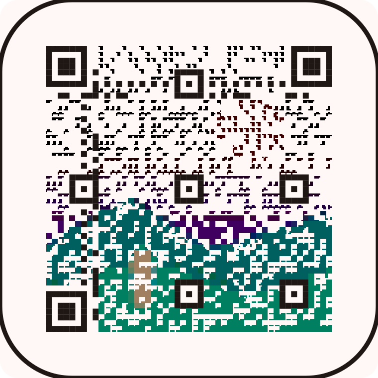
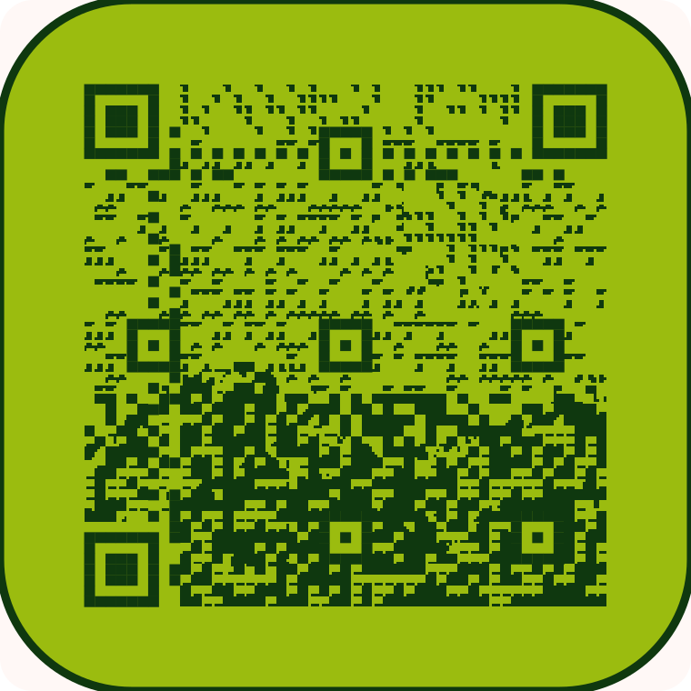
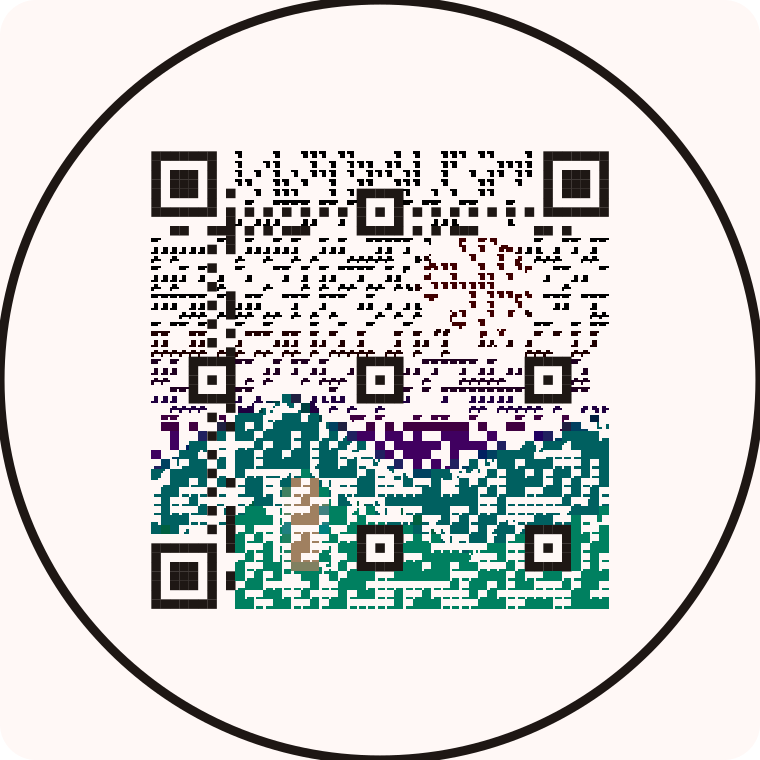
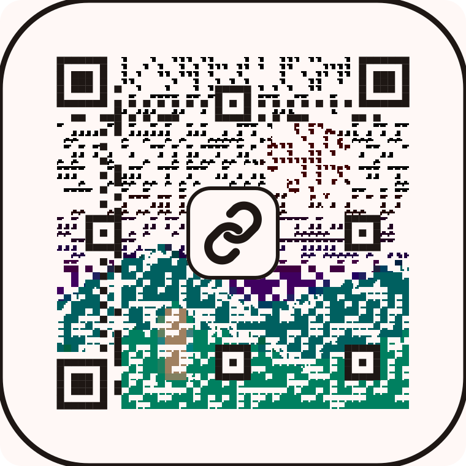
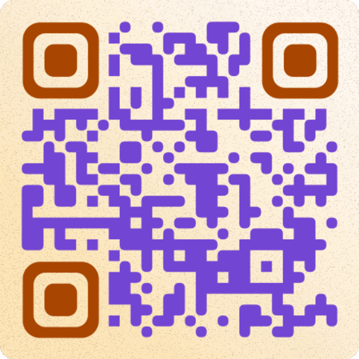
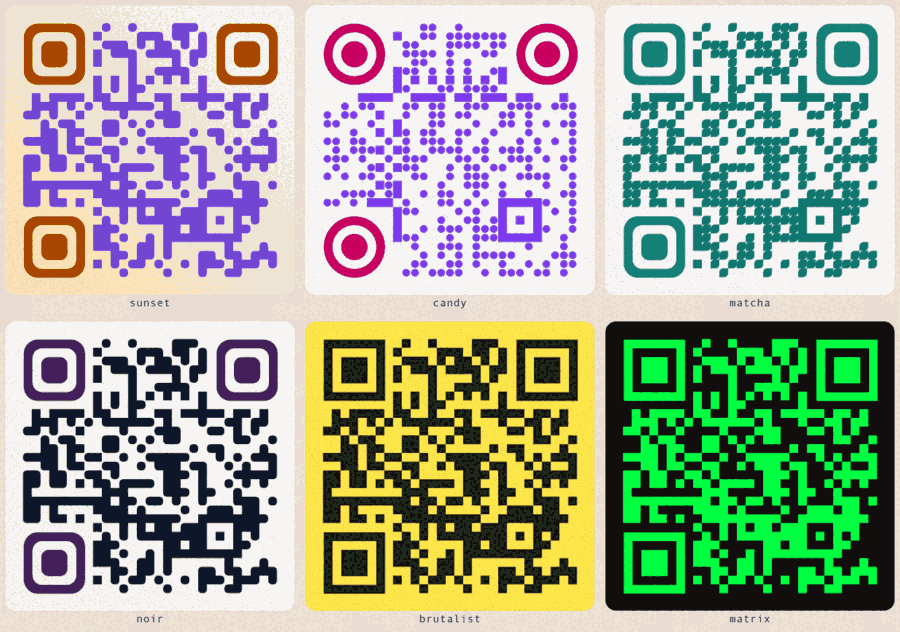

# Looks — Classic, Halftone, Flat Foil

Three presentation modes that sit **on top of** the palette engine. A look
changes how the matrix is dressed, never which modules carry the data.

| Look      | What it is                              | The idea                                          |
| --------- | --------------------------------------- | ------------------------------------------------- |
| Classic   | The flat, print-tested matrix. Default. | The code is the subject                           |
| Halftone  | The artwork becomes the ink             | The picture is the subject, the code is its grain |
| Flat Foil | A flat code printed on an extruded tile | The code is an object                             |

## The inversion

The first pass at this shipped three skins: a sticker with a photo behind the
dots, an 8-bit colourway, a foil tile. They were the same QR wearing different
jackets, and the controls were decoys — three face colours exist because the
renderer has three faces, not because anyone has three decisions to make.

Halftone is the correction. The artwork stops being a background and becomes the
ink. The matrix decides _where_ a mark goes; the picture decides _how heavy_ and
_what colour_ it is. Same shape as a screen print.

## In the app

| Design tab, desktop                                     | Design tab, 375px                                     |
| ------------------------------------------------------- | ----------------------------------------------------- |
|  |  |

| Halftone · Colour                        | Halftone · DMG                                     | Halftone · Circle                                            |
| ---------------------------------------- | -------------------------------------------------- | ------------------------------------------------------------ |
|  |  |  |

| Halftone · centre mark                                    | Flat Foil                                   |
| --------------------------------------------------------- | ------------------------------------------- |
|  |  |

| Riso · Sunset                                           | Riso across the palettes                                |
| ------------------------------------------------------- | ------------------------------------------------------- |
|  |  |

## The laws every look obeys

1. Finder, timing and alignment patterns are never decorative. They are drawn
   full size at full contrast, and a paper plate erases the artwork behind the
   separators before anything is drawn on top.
2. The quiet zone is at least **4 modules** in every look, measured inside the
   plate edge.
3. Every look renders from the same matrix the classic path draws. A look can
   never invent a module the decoder will not see.
4. Error correction is forced to **H** whenever a look is active.
5. A look is only offered as print-ready after a real decoder reads the exact
   render on screen. The gallery tick is that verdict, not a promise.

## Print

Print is orthogonal to the look: any look comes off any of the three presses. It
lives in `utils/qr-print.ts` and is seeded from the payload, so a link always
prints the same sheet.

| State   | What it is                                                                                                                                                               |
| ------- | ------------------------------------------------------------------------------------------------------------------------------------------------------------------------ |
| `clean` | Vector-clean. What the studio has always shipped.                                                                                                                        |
| `paper` | A tooth of ink-dark specks at ~3.5% coverage, drawn **under** the code. No module ever changes, so the decoder never notices.                                            |
| `riso`  | Paper plus a second spot drum. On a module code the eye plate is registered a hair off and both inks go flat; on a halftone the picture is separated onto the two spots. |

**Why misregistration and not a bite.** The first attempt at grain was a
_coverage_ effect: paper specks punched out of the ink. Ink is the information,
so the denser the code the more damage per speck — it only survived on chunky
codes and the halftone needed a threshold so high the bite was invisible.
Registration is a _colour_ effect. Nothing is removed, so density cannot fight
it, and the tell is the same one a real press gives you.

**Two drums, honestly.** A palette built for a gradient is not automatically a
flat ink, so `risoInks()` does two things: if the palette's two inks are already
far apart (Sunset, Candy, Grape, Vapor, Crimson) it uses them; if they are
near-identical (Classic, Forest, Ocean, Brutal) the press mixes a second drum
from the same hue rather than printing one colour twice and calling the offset a
design. Every drum is then walked away from the paper until it clears a
**4.6:1** contrast floor, because a pale lavender handed over by a gradient
palette is a code that does not read.

**Riso takes the Ink control over.** On a halftone, `riso` separates the picture
onto the two spots, so the Ink row hides rather than sitting inert.

## Halftone

Each module is a **4 × 4 sub-grid** of ink cells.

- The centre **2 × 2 is forced**: ink for a dark module, paper for a light one.
  That is the patch a decoder samples, so polarity is guaranteed no matter what
  the picture is doing there.
- The surrounding **12 cells follow the photograph**, sampled per sub-cell, so
  the halftone resolves at four times the module grid.
- A dark module keeps at least 7 of 16 cells inked and a light one at most 3, so
  a bright sky can never open a data module into paper and a dark shadow can
  never flood a light one.
- The photo's tones are histogram-stretched at the 5th/95th percentile before
  dithering. Most photos live in the middle; min/max would flatten the halftone
  into one density.
- Colour is per module: hue survives, value is pinned into a narrow dark band,
  and chroma is lifted so a printed hue does not turn to mud.

**Tones.** `Colour` keeps the picture's hues. `DMG` prints the four-green set
(`#9BBC0F / #8BAC0F / #306230 / #0F380F`) — the Game Boy flavour without the
trademark. `Ink` is the palette's own ink for a one-colour print.

**Detail.** `Soft` tints: the code decides every module, the picture only
decides how heavy it is. `Sharp` spends part of the Reed–Solomon budget so the
code can actually _move_ where the picture disagrees with it.

Reed–Solomon budgets in whole codewords — one wrong bit costs the same as eight
— so `utils/qr-codewords.ts` rebuilds the ISO 18004 placement order, groups the
data area into codewords, and inverts whole eight-module chunks. The map is
verified against the standard codeword totals for all 40 versions.

Measured on a v8-H short link (242 codewords, 250px probe), flipping whole
codewords at random: 60 (25%) passes, 66 (27%) rolls dice, 74 fails. So the
default is **16% — 39 codewords at v8** — leaving a third of the budget for a
scuffed print. A centre mark scales it to 40% of that and a circular plate to
45%, because a badge and a smaller code spend the same margin.

**Plates.** `Square` (88% of the plate), `Round` (88%), `Circle` (70% — the
inscribed square, so the ring never clips the code).

**Grid.** A halftone renders at **version 8 (49 modules) minimum**, whatever the
payload needs. At 25 modules the picture is a mosaic; at 49 it reads on the
336px stage and still gives a 1000px print 196 halftone cells. The payload's own
version wins if it is higher.

**Artwork** is sampled once, at upload: a 64 × 64 RGB grid, about 16 KB as
base64, stored beside the design. Rendering never touches an image, so the
export path stays pure and no external URL can taint a canvas.

## Flat Foil

A flat, perfectly readable code on a lofted slab: 18 offset plates build one
continuous side wall with rounded edges. The first implementation ported
`QR25D`'s isometric plane directly — it looked right and **failed the decoder at
250px on every render size**. The top face stayed flat; the thickness moved into
the object.

One decision, not three: **depth** (thin card stock or a chunky block). The face
inks come from the active palette.

## What got cut, and why

- **Pocket** was a look the way a paint colour is a car. It is now the `DMG`
  tone inside Halftone, which is where the four-greens actually matter.
- **Sticker** put a photo behind shrunken dots on a scrim. It read as a photo
  with a QR stuck on it, which is the opposite of the point. Halftone replaces
  it.
- **The foil face mixer** (top/left/right) let you recolour the inside of the
  renderer. Depth is the choice a printer makes.

## Decoder gate

Method: `zxing-wasm` 2.1.2, QR-only, `tryHarder + tryInvert`, rendered to a
**250 × 250 probe** — the same probe `checkQRScannability` uses on the stage.
Payload `https://qrbuddy.app`, palette Sunset, a real photograph as the sample.

| Look                    | 300px | 1000px | 2000px | 3000px |
| ----------------------- | ----- | ------ | ------ | ------ |
| Classic                 | pass  | pass   | pass   | pass   |
| Classic · mark          | pass  | pass   | pass   | pass   |
| Halftone · Colour       | pass  | pass   | pass   | pass   |
| Halftone · DMG          | pass  | pass   | pass   | pass   |
| Halftone · Ink          | pass  | pass   | pass   | pass   |
| Halftone · Square plate | pass  | pass   | pass   | pass   |
| Halftone · Circle plate | pass  | pass   | pass   | pass   |
| Halftone · mark         | pass  | pass   | pass   | pass   |
| Halftone · DMG · mark   | pass  | pass   | pass   | pass   |
| Flat Foil · thin        | pass  | pass   | pass   | pass   |
| Flat Foil · chunky      | pass  | pass   | pass   | pass   |
| Flat Foil · mark        | pass  | pass   | pass   | pass   |

48 of 48 cases decode at the 250px probe. The isometric foil prototype failed
all four sizes on the same probe, which is why it is not in this table.

The live gallery runs the same check per look and caches the verdict against a
hash of the rendered SVG. A failing look shows an amber `!`.

## Limits worth knowing

- **Small screens undersell it.** A 49-module halftone is texture at thumbnail
  size; the photo lands at print size. The Design tab previews it at 196px and
  the download at 1000–3000px is the artifact.
- **Photos with huge flat highlights** (blown sky) leave the code sparse in that
  region. It still decodes; it just looks airy.
- **A centre mark costs ~6% of the code area.** H carries it, and the decoder
  gate proves it, but a very long payload plus a big badge is still greedy.
- **Sharp is a budget, not a guarantee.** It spends error correction the print
  might need later. On cheap stock or behind glass, `Soft` is the safer print.
- **Circle plates waste the most area** — under ~30mm print, prefer round or
  square.
- Looks are **not carried in share links** (`/q?s=`) yet. Batch Studio stays on
  Classic.

## Files

- `utils/qr-art-renderers.ts` — foil loft and the halftone sub-grid
- `utils/qr-print.ts` — tooth, riso drums, registration, contrast floor
- `utils/qr-art-sample.ts` — sampling, base64 grid, palette default
- `utils/qr-codewords.ts` — placement order, codeword grouping, flip ranking
- `utils/qr-vector-svg.ts` — mode dispatch, version floor, mark badge,
  `data-look`
- `utils/qr-renderer.ts` — one geometry source for preview, stage and export
- `components/create-modal/LookGallery.tsx` — gallery, look options, verdict
  cache
- `tests/looks_test.ts` — sampling, polarity caps, codeword map, byte budget
- `THIRD_PARTY_LICENSES.md` — what informed the looks and under what licence
