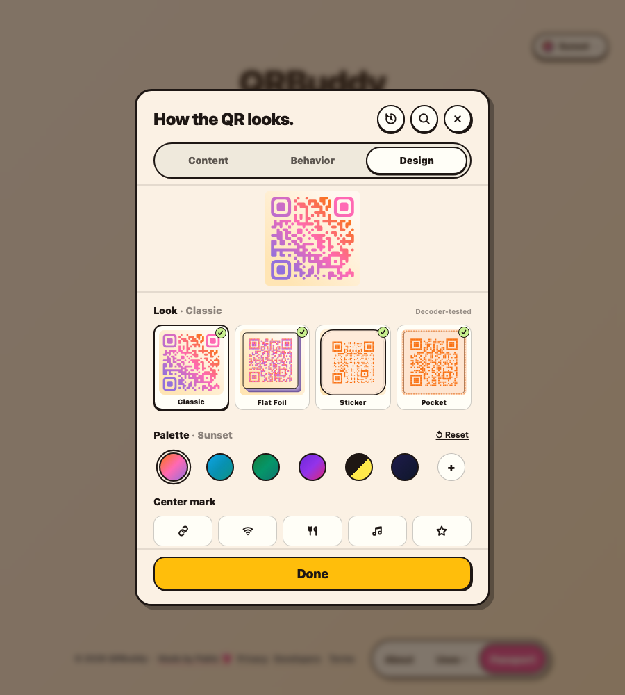
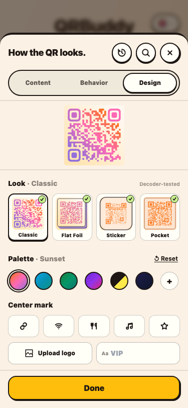
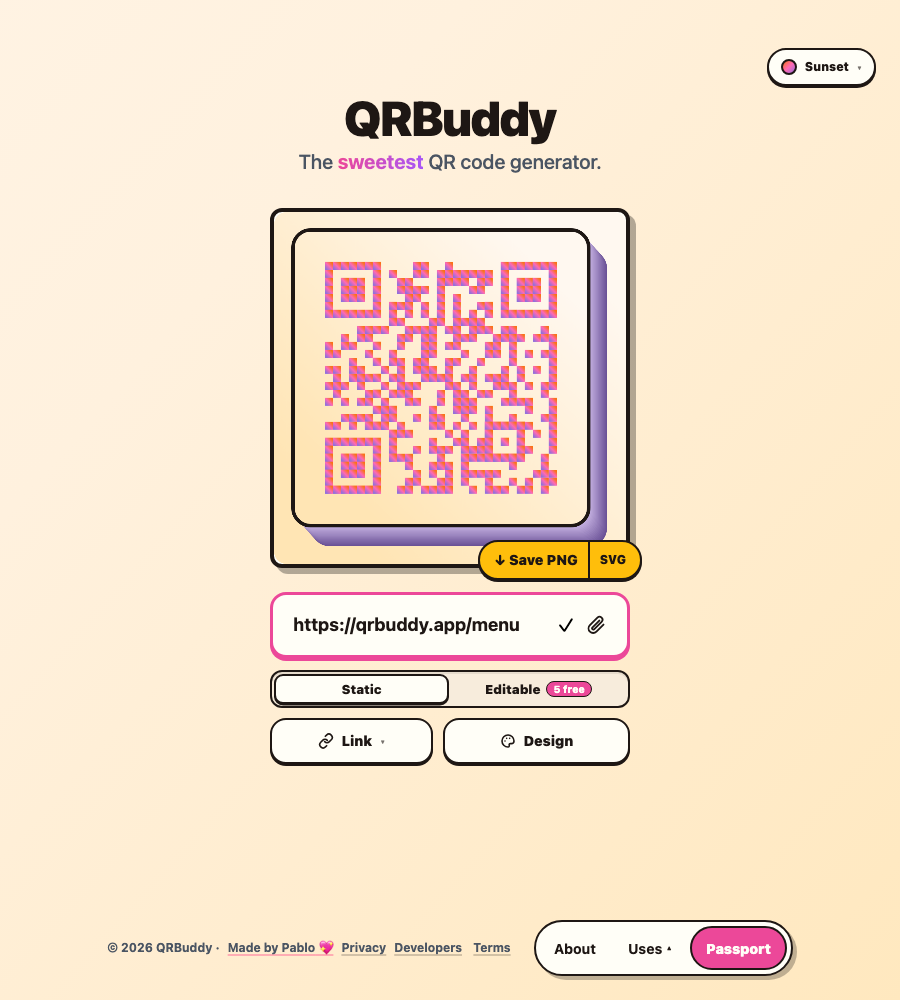
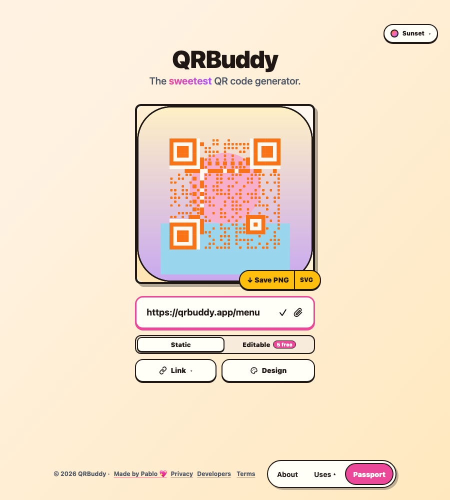
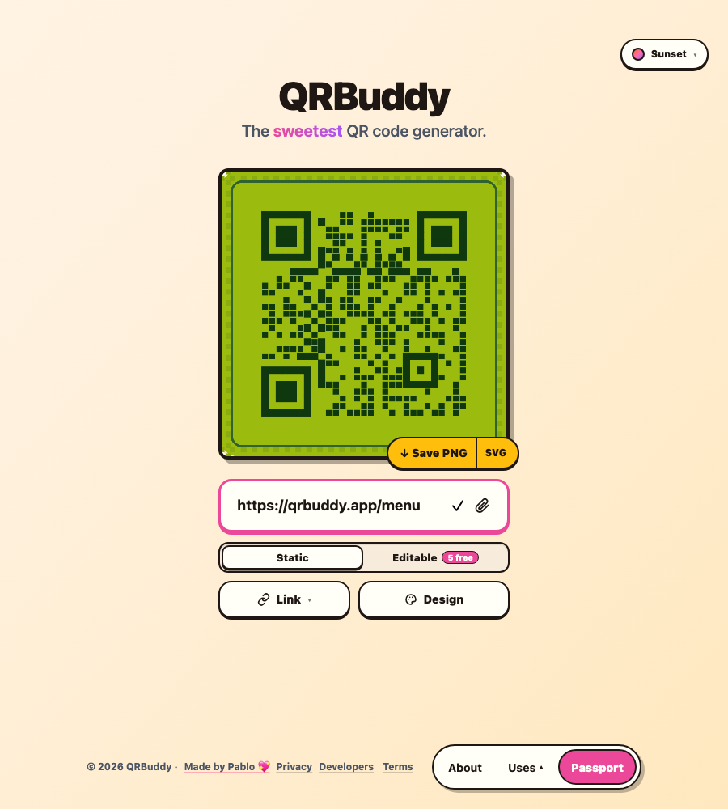
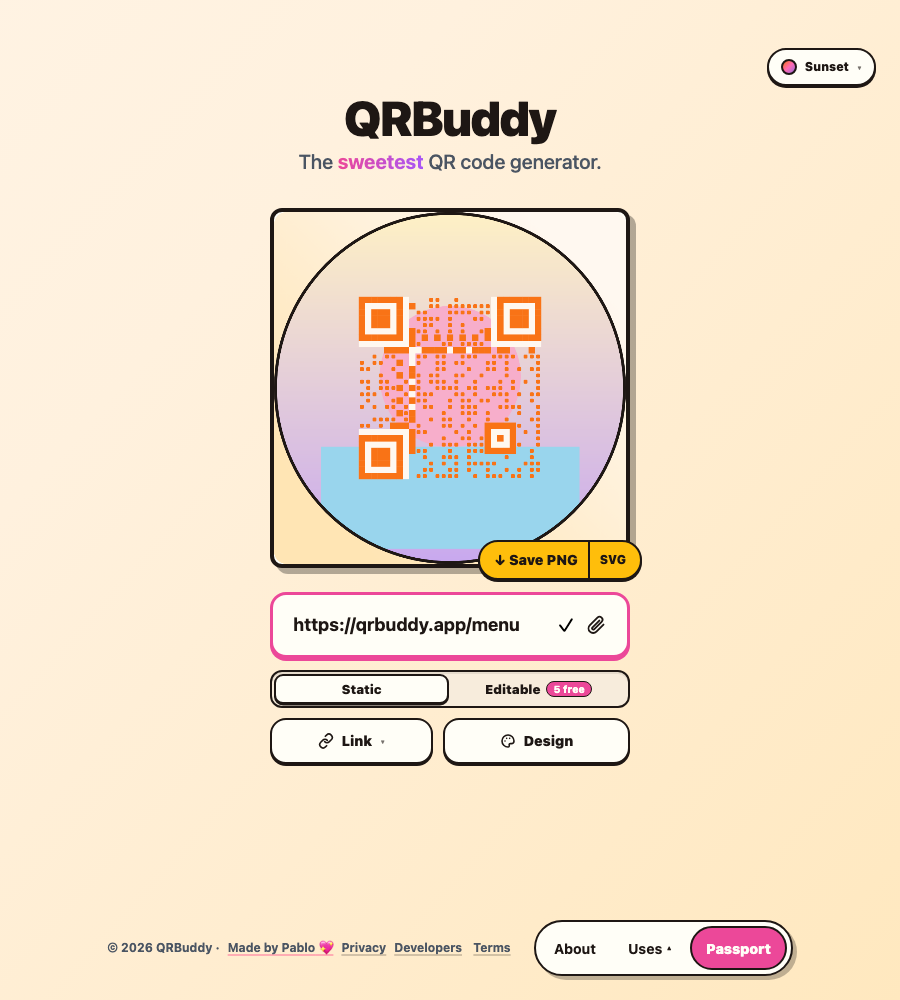

# Looks — Flat Foil, Sticker, Pocket

Four presentation modes that sit **on top of** the existing palette engine. A
look changes how the matrix is dressed, never which modules carry the data. The
palette, centre mark, gradients and print frame keep working with every look.

| Look      | What it is                                    | Palette geometry                      |
| --------- | --------------------------------------------- | ------------------------------------- |
| Classic   | The flat, print-tested matrix. Default.       | Rounded / dots / classy module shapes |
| Flat Foil | A flat code printed on an extruded tile       | Square modules, three face inks       |
| Sticker   | Artwork behind a protected code, die-cut edge | Rounded halftone modules              |
| Pocket    | 8-bit tile sticker with a stitched bezel      | Chunky square modules                 |

## In the app

| Design tab, desktop                                     | Design tab, 375px                                     |
| ------------------------------------------------------- | ----------------------------------------------------- |
|  |  |

| Flat Foil                                   | Sticker                                                   | Pocket · DMG                                   |
| ------------------------------------------- | --------------------------------------------------------- | ---------------------------------------------- |
|  |  |  |

A circular die-cut, for sticker badges and coasters:

## The laws every look obeys

1. Finder, timing and alignment patterns are never decorative. They are drawn
   full size at full contrast, and a paper protector erases the artwork behind
   the separators before any module is drawn.
2. The quiet zone is at least **4 modules** in every look, measured inside the
   die-cut edge.
3. Every look is rendered by the same matrix the classic path draws. A look can
   never invent a module the decoder will not see.
4. Error correction is forced to **H** whenever a look is active, so the
   artwork's reduced data modules and any centre badge are covered by parity.
5. A look is only offered as print-ready after a real decoder reads the exact
   render on screen. The gallery's tick is that verdict, not a promise.

## Flat Foil

The reference geometry (an isometric projection of the whole code) looked right
and **failed the decoder gate at 250px on every render size** — 300, 1000, 2000
and 3000px. An affine skew is recoverable in theory, but finder sampling at
print resolution is not, so the projection was dropped.

The shipped foil keeps the top face flat and moves the thickness into the
object: an 18-plate loft builds one continuous side wall under a square code.
The result scans exactly like Classic, and still reads as a physical block.

- Face inks: **Top / Left / Right**, each defaulting to a palette-derived tone
  (`left = dots → ink 34%`, `right = dots → paper 52%`). `Auto` restores them.
- The centre mark floats on the tile instead of excavating it, so no modules are
  lost under a skewed hole. Deeper contrast, same scan result.

## Sticker

Artwork (photo, logo, mascot, texture) is painted behind the code and dimmed
with a paper scrim, while the data modules shrink to 62% so the art breathes
between them. Function patterns stay at 102% (a hair of overlap so print
resolution never shows a hairline seam inside a finder ring).

- Artwork must be a same-origin raster (`data:image/png|jpeg|webp`). Remote URLs
  are ignored: they would taint the export canvas, and an inline SVG could carry
  foreign content into a file that gets printed and shipped.
- The upload is downscaled to 900px and re-encoded, then capped at the same
  stored size as a centre mark.
- Die-cut edges: **Squircle** (usable area 84%), **Circle** (69% — the inscribed
  square of a circle), **Ticket** (78%, notch on both mid edges). The code is
  always placed inside the shape, never clipped by it.
- A faint kiss-cut line traces the inside of the edge — the sticker-sheet tell.
- With no artwork the card keeps the die-cut edge and a light tint of the active
  palette, so the look is still legible as an object rather than an empty box.

## Pocket

QRBuddy's own 8-bit look. No Nintendo trademark is used anywhere in the UI or
the export.

- Squared modules at 82%, a stitched pixel bezel, a chunky outline.
- Tones: **Palette** derives a four-tone set from the active palette; **DMG**
  uses `#9BBC0F / #8BAC0F / #306230 / #0F380F`.
- Structural modules are drawn at 104% so the finder rings stay solid at print
  size.

## Decoder gate

Method: `zxing-wasm` 2.1.2, QR-only, `tryHarder + tryInvert`, rendered to a
**250×250 probe** — the same probe `checkQRScannability` uses on the stage, so
the gallery tick and the stage chip agree. Payload `https://qrbuddy.app`,
palette Sunset.

| Look                       | 300px | 1000px | 2000px | 3000px |
| -------------------------- | ----- | ------ | ------ | ------ |
| Classic                    | pass  | pass   | pass   | pass   |
| Flat Foil                  | pass  | pass   | pass   | pass   |
| Sticker                    | pass  | pass   | pass   | pass   |
| Pocket                     | pass  | pass   | pass   | pass   |
| Pocket · DMG               | pass  | pass   | pass   | pass   |
| Sticker · Ticket           | pass  | pass   | pass   | pass   |
| Sticker · Circle           | pass  | pass   | pass   | pass   |
| Sticker · Artwork          | pass  | pass   | pass   | pass   |
| Sticker · Artwork · Circle | pass  | pass   | pass   | pass   |
| Classic · Mark             | pass  | pass   | pass   | pass   |
| Flat Foil · Mark           | pass  | pass   | pass   | pass   |
| Sticker · Mark             | pass  | pass   | pass   | pass   |
| Pocket · Mark              | pass  | pass   | pass   | pass   |

52 of 52 cases decode at the 250px probe. The isometric foil prototype failed
all four sizes on the same probe, which is why it is not in this table.

The live gallery runs the same check per look and caches the verdict against a
hash of the rendered SVG, so typing in the URL box never re-decodes an unchanged
picture. A failing look shows an amber `!` and is never labelled print-ready.

## Limits worth knowing

- **Centre marks** cover more of a foil than of a classic code. H keeps it
  scannable at the sizes above; a very long payload plus a big badge is still a
  bad idea, and the stage chip will say so.
- **Sticker artwork** reduces the data modules' ink. A very busy photo with high
  local contrast lowers the margin; the scrim and the H level are the guard, not
  a guarantee against every photo.
- **Circle** stickers waste the most area. On small print (under ~30mm) prefer
  squircle or ticket.
- **Pocket DMG** is a print colour set. On screen it can read bright; on a matte
  sticker stock it reads correct.
- Looks are **not yet carried in share links** (`/q?s=`) — a link keeps the
  palette, not the look. Batch Studio also stays on classic.

## Files

- `utils/qr-art-renderers.ts` — the three renderers, die-cut paths, protector
  logic, colour mixing
- `utils/qr-vector-svg.ts` — mode dispatch, mark badge, `data-look` stamp
- `utils/qr-renderer.ts` — one geometry source for preview, stage and export
- `components/create-modal/LookGallery.tsx` — the gallery, per-look options,
  verdict cache
- `tests/looks_test.ts` — geometry, protection, persistence and byte budget
- `THIRD_PARTY_LICENSES.md` — what informed the looks and under what licence
